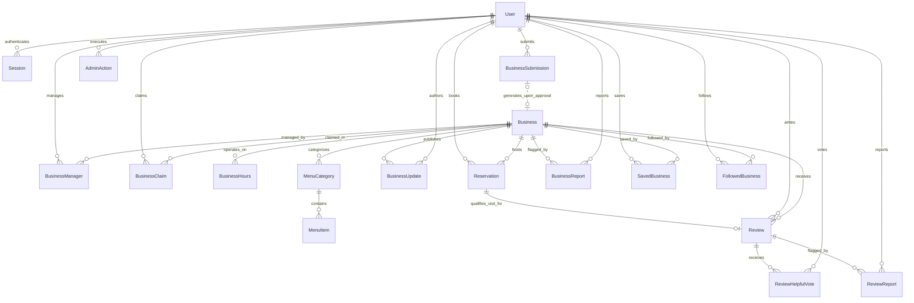

# CAFNET BACKEND ENTITY RELATIONSHIPS SPECIFICATION
**Document ID:** `CAFNET-BACKEND-01-ENTITY-RELATIONSHIPS`  
**Status:** Canonical Architecture Specification  
**Target Stack:** Go 1.23+, Neon PostgreSQL  

---

## 1. Entity-Relationship Diagram (ERD)

The following diagram defines the canonical relationships between all entities in the Cafnet backend.

---

## 2. Cardinality Matrix & Referential Semantics

| Parent Entity | Child / Related Entity | Cardinality | Join Mechanism | Relationship Semantic |
| :--- | :--- | :--- | :--- | :--- |
| `User` | `Session` | `1 : N` | `user_id` FK | A user can maintain multiple active sessions across mobile and desktop. |
| `User` | `Business` | `M : N` | `BusinessManager` join | A user may manage zero, one, or multiple businesses; a business may have multiple authorized managers. |
| `User` | `BusinessClaim` | `1 : N` | `claimant_user_id` FK | A user may submit multiple claims over time. |
| `Business` | `BusinessClaim` | `1 : N` | `business_id` FK | A business may receive multiple claims (e.g. historical rejected claims), but at most one pending claim is active. |
| `User` | `BusinessSubmission`| `1 : N` | `submitter_user_id` FK | A user may propose multiple new businesses for directory addition. |
| `Business` | `BusinessHours` | `1 : 7` | `business_id` FK | Exactly 7 schedule rows (one per day of week, 0=Sun to 6=Sat) per business. |
| `Business` | `MenuCategory` | `1 : N` | `business_id` FK | A business organizes its dishes into zero or more ordered categories. |
| `MenuCategory` | `MenuItem` | `1 : N` | `category_id` FK | A category contains zero or more ordered menu items. |
| `Business` | `BusinessUpdate` | `1 : N` | `business_id` FK | A business publishes announcements, offers, events, and price changes. |
| `User` | `Reservation` | `1 : N` | `customer_user_id` FK | A customer initiates table reservation requests. |
| `Business` | `Reservation` | `1 : N` | `business_id` FK | A business receives and manages incoming reservation requests. |
| `Reservation` | `Review` | `1 : 1` (Optional) | `reservation_id` FK (Unique)| A completed reservation yields at most **one** review. A review cannot exist without a completed reservation. |
| `Review` | `ReviewHelpfulVote` | `1 : N` | `review_id` FK | Customers cast upvotes marking reviews as helpful. Unique per `(review_id, customer_user_id)`. |
| `Review` | `ReviewReport` | `1 : N` | `review_id` FK | Multiple users can report a suspicious review. Unique per `(review_id, reporter_user_id)`. |
| `Business` | `BusinessReport` | `1 : N` | `business_id` FK | Multiple users can submit issue reports regarding venue accuracy. |
| `User` | `SavedBusiness` | `M : N` | `(user_id, business_id)` PK | Customer bookmark list. |
| `User` | `FollowedBusiness` | `M : N` | `(user_id, business_id)` PK | Customer update subscription feed. |
| `User` (Admin) | `AdminAction` | `1 : N` | `admin_user_id` FK | Audit trail of governance actions executed by administrators. |

---

## 3. Data Ownership Matrix

Every entity in Cafnet has strict jurisdictional boundaries defining who creates, owns, manages, and holds administrative governance authority over it:

| Entity | Creator | Owner / Subject | Authorized Manager | Administrative Authority |
| :--- | :--- | :--- | :--- | :--- |
| **`User`** | Self (Registration) | Self | Self (Edit profile, sign out) | Admin (Ban, promote, deactivate) |
| **`Session`** | System (Auth) | User | User (Revoke) | Admin / System (Expire, invalidate) |
| **`Business`** | Admin or Submitter | Venue Identity | Authorized `BusinessManager`(s) | Admin (Verify, unpublish, edit, soft-delete) |
| **`BusinessManager`**| Admin (Approval) | Business & User | Business Primary Owner | Admin (Assign, revoke, override) |
| **`BusinessClaim`** | User (Claimant) | Claimant | Claimant (View status) | Admin (Approve, reject with reason) |
| **`BusinessSubmission`**| User (Submitter) | Submitter | Submitter (View status) | Admin (Approve, reject with reason) |
| **`MenuCategory`** | Business Manager | Business | Authorized `BusinessManager`(s) | Admin (Full governance oversight) |
| **`MenuItem`** | Business Manager | Business | Authorized `BusinessManager`(s) | Admin (Full governance oversight) |
| **`BusinessUpdate`**| Business Manager | Business | Authorized `BusinessManager`(s) | Admin (Takedown violating updates) |
| **`Reservation`** | Customer | Customer & Business | Customer (Cancel), Manager (Confirm, decline, complete) | Admin (View, resolve dispute) |
| **`Review`** | Customer | Customer (Author) | Customer (Edit text/rating, soft-delete) | Admin (Moderate, remove from public listing) |
| **`ReviewHelpfulVote`**| Customer | Customer | Customer (Toggle vote) | System (Purge if review/user deleted) |
| **`ReviewReport`** | Customer | Reporter | Reporter (View status) | Admin (Dismiss or action/remove review) |
| **`BusinessReport`**| Customer | Reporter | Reporter (View status) | Admin (Dismiss or action/correct business) |
| **`SavedBusiness`** | Customer | Customer | Customer (Save, unsave) | System (Cascade delete if user/business deleted) |
| **`FollowedBusiness`**| Customer | Customer | Customer (Follow, unfollow) | System (Cascade delete if user/business deleted) |
| **`AdminAction`** | Admin | Platform | Immutable (No edits permitted) | Platform Compliance (Append-only) |

---

## 4. Foreign Key & Deletion Semantics

To prevent data corruption, orphaned relationships, or broken historical audits, foreign keys adhere to explicit cascade vs. restrict policies:

### 4.1 Cascade Delete (`ON DELETE CASCADE`)
Used strictly for child entities and join relationships that have no independent meaning outside the parent entity:
- `BusinessHours` $\rightarrow$ `ON DELETE CASCADE` from `Business`
- `MenuCategory` $\rightarrow$ `ON DELETE CASCADE` from `Business`
- `MenuItem` $\rightarrow$ `ON DELETE CASCADE` from `MenuCategory`
- `BusinessUpdate` $\rightarrow$ `ON DELETE CASCADE` from `Business`
- `BusinessManager` $\rightarrow$ `ON DELETE CASCADE` from `Business` / `User`
- `SavedBusiness` $\rightarrow$ `ON DELETE CASCADE` from `Business` / `User`
- `FollowedBusiness` $\rightarrow$ `ON DELETE CASCADE` from `Business` / `User`
- `ReviewHelpfulVote` $\rightarrow$ `ON DELETE CASCADE` from `Review` / `User`

### 4.2 Restrict / Soft Delete Preservation (`ON DELETE RESTRICT`)
Used for critical business audit records and legal history:
- `Reservation`: NEVER hard-deleted when a Business or User is soft-deleted. Historical reservations are retained for accounting, verification audits, and dining records.
- `Review`: Linked to `Reservation`. If a customer deletes their review, it is soft-deleted (`deleted_at = NOW()`). If an administrator removes it, `status = 'REMOVED_BY_ADMIN'`. The underlying reservation remains intact.
- `BusinessClaim` & `BusinessSubmission`: Preserved even if claimant accounts are deactivated to ensure a permanent audit trail of claiming history.
- `AdminAction`: Cannot be deleted under any circumstance.
