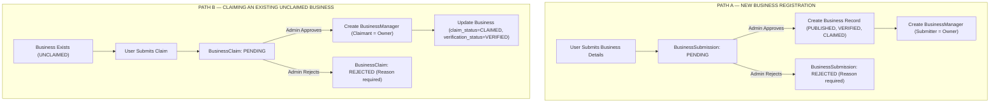
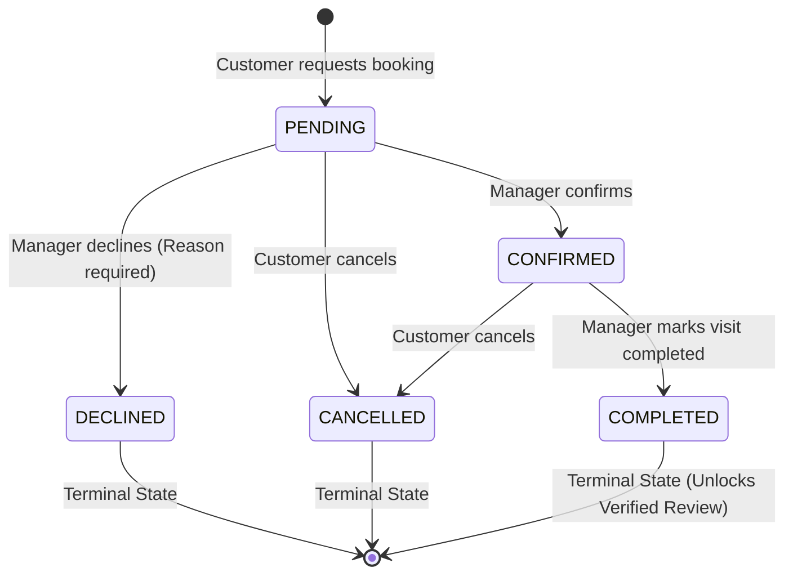
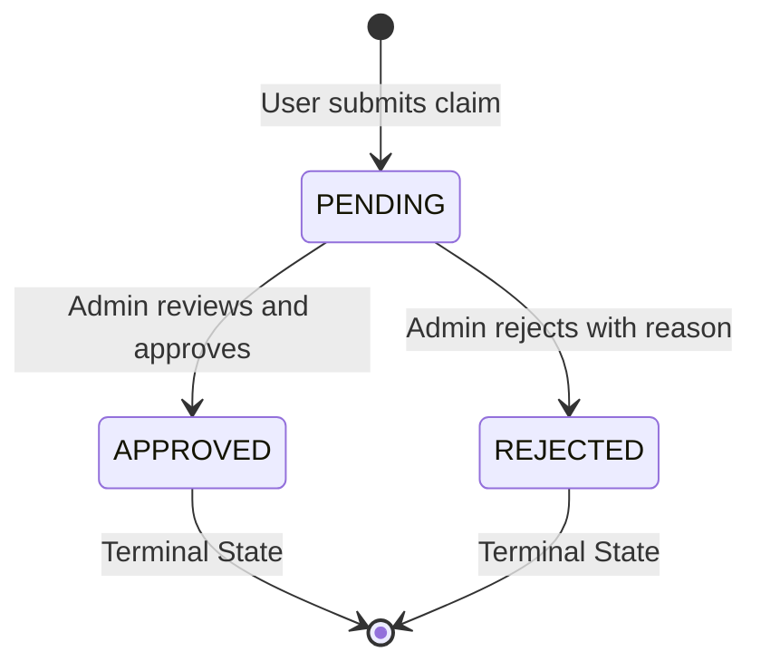
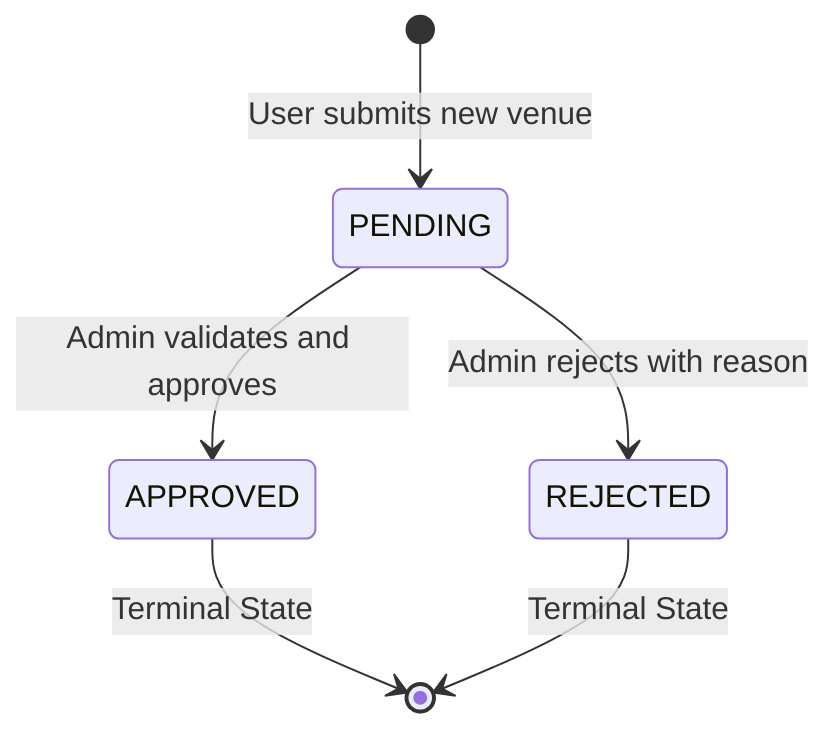
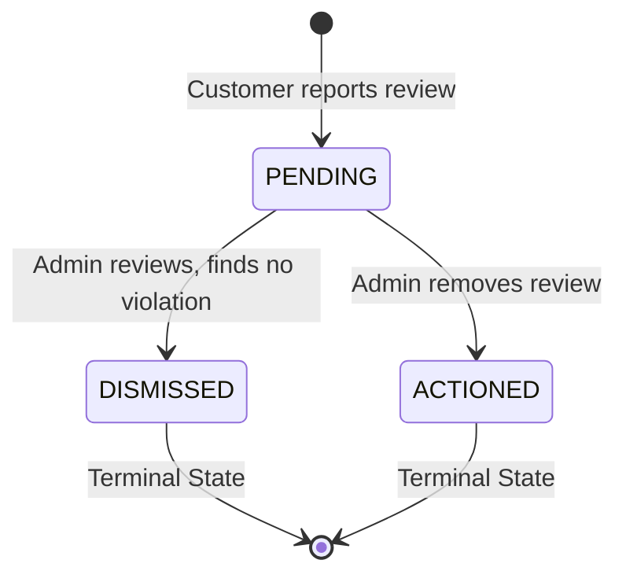
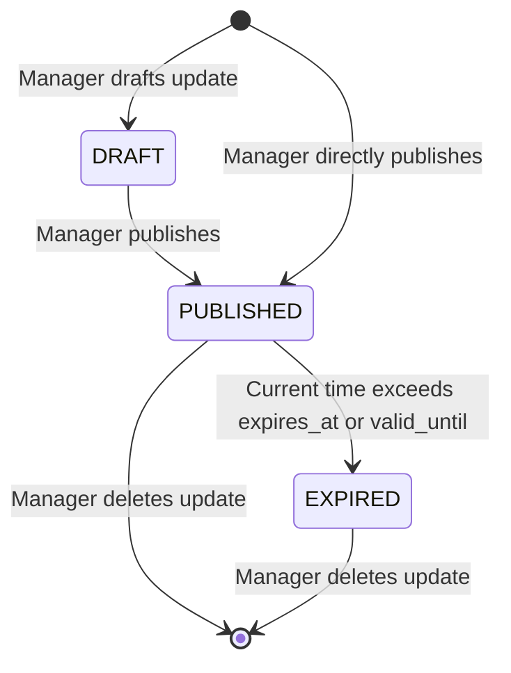

# CAFNET BACKEND STATE MACHINES SPECIFICATION
**Document ID:** `CAFNET-BACKEND-01-STATE-MACHINES`  
**Status:** Canonical Architecture Specification  
**Target Stack:** Go 1.23+, Neon PostgreSQL  

---

## 1. Business Lifecycle & Entry Pathways

Cafnet provides two distinct, non-conflicting entry paths for venues entering the directory.



### 1.1 The Four Orthogonal Business Dimensions

A frequent architectural flaw in marketplace platforms is conflating directory presence with ownership and trust. In Cafnet, these four concepts are **strictly orthogonal**:

```
+---------------------------------------------------------------------------------------+
|  DIMENSION          | POSSIBLE VALUES            | RESPONSIBILITY                     |
+---------------------+----------------------------+------------------------------------+
|  1. Existence       | In DB vs Deleted (Soft)    | Raw database row presence          |
|  2. Publication     | PUBLISHED vs UNPUBLISHED   | Visibility in public discovery     |
|  3. Ownership       | UNCLAIMED vs CLAIMED       | Presence of an authorized manager  |
|  4. Verification    | VERIFIED vs UNVERIFIED     | Platform badge of authenticity     |
+---------------------------------------------------------------------------------------+
```

#### Canonical Public Discoverability Rule
A business is discoverable publicly by customers **if and only if**:
$$\text{is\_discoverable} \iff (\text{publication\_status} = \text{'PUBLISHED'} \land \text{deleted\_at IS NULL})$$

*Crucial Domain Invariants:*
- An **unclaimed** business can still be **published** (e.g. community directory listing seeded or verified by Cafnet curators).
- An **approved claim** does not change publication status; it grants management access and marks the business as `CLAIMED` and `VERIFIED`.
- An **unpublished** business hides the venue, its menu, its updates, and booking availability from public discovery, but retains all historical reservations and reviews in backend administration.

---

## 2. Reservation Lifecycle State Machine

The table reservation flow is the operational centerpiece of Cafnet. It controls customer bookings, restaurant capacity management, and visit verification for reviews.



### 2.1 Reservation Transition Matrix

| Current State | Target State | Authorized Actor | Preconditions | Side Effects & Invariants |
| :--- | :--- | :--- | :--- | :--- |
| **`INITIAL`** | `PENDING` | Authenticated Customer | `party_size > 0`, valid future slot, business has `reservation_available = TRUE` | Stamps `created_at`. Generates customer-facing reference code (e.g. `CAF-1001`). |
| **`PENDING`** | `CONFIRMED` | Business Manager / Admin | Target reservation is currently `PENDING`. | Stamps `confirmed_at` and `reviewed_by_user`. Notifies customer. |
| **`PENDING`** | `DECLINED` | Business Manager / Admin | Reason text must be non-empty. | Stamps `declined_at`, records `decline_reason` and `reviewed_by_user`. Terminal. |
| **`PENDING`** | `CANCELLED` | Customer (Author) | Must be the customer who initiated the booking. | Stamps `cancelled_at`. Terminal. |
| **`CONFIRMED`** | `CANCELLED` | Customer (Author) | Cancellation policy check (booking time is in future). | Stamps `cancelled_at`. Releases table capacity. Terminal. |
| **`CONFIRMED`** | `COMPLETED` | Business Manager / Admin | Current time has arrived/passed the booking time slot. | Stamps `completed_at` and `reviewed_by_user`. **Unlocks verified review submission**. Terminal. |

### 2.2 Illegal / Forbidden Transitions
- `COMPLETED` $\rightarrow$ Any (A completed visit can never be cancelled, declined, or reset to pending).
- `DECLINED` $\rightarrow$ Any (A declined reservation cannot be resurrected; a customer must create a new request).
- `CANCELLED` $\rightarrow$ Any (A cancelled reservation cannot be re-opened).
- `PENDING` $\rightarrow$ `COMPLETED` (A restaurant cannot mark a visit completed without first confirming it).

---

## 3. Business Claim State Machine

Controls the administrative workflow when a user asserts ownership over an existing directory listing.



### 3.1 Claim Transition Matrix

| Current State | Target State | Authorized Actor | Preconditions | Side Effects |
| :--- | :--- | :--- | :--- | :--- |
| **`INITIAL`** | `PENDING` | Authenticated User | Business exists; no other active `PENDING` claim; business is `UNCLAIMED`. | Stamps `submitted_at`. |
| **`PENDING`** | `APPROVED` | Platform Admin | Business is not already claimed by another user. | 1. `BusinessClaim.status = 'APPROVED'`<br>2. Inserts `BusinessManager(user_id, business_id, 'PRIMARY_OWNER')`<br>3. Updates `Business.claim_status = 'CLAIMED'` and `Business.verification_status = 'VERIFIED'`<br>4. Stamps `reviewed_at` and `reviewed_by`. |
| **`PENDING`** | `REJECTED` | Platform Admin | `rejection_reason` must not be blank. | 1. `BusinessClaim.status = 'REJECTED'`<br>2. Records `rejection_reason`<br>3. Business remains `UNCLAIMED`. Claimant receives no management permissions. |

---

## 4. Business Submission State Machine

Controls the submission of completely new listings into Cafnet.



### 4.1 Submission Transition Matrix

| Current State | Target State | Authorized Actor | Preconditions | Side Effects |
| :--- | :--- | :--- | :--- | :--- |
| **`INITIAL`** | `PENDING` | Authenticated User | Submitter must provide valid name, category, and neighborhood area. | Preserves full draft data in `submitted_payload` JSONB. Stamps `submitted_at`. |
| **`PENDING`** | `APPROVED` | Platform Admin | Venue details vetted for platform quality. | 1. Inserts new `Business` row with `publication_status = 'PUBLISHED'`, `claim_status = 'CLAIMED'`, `verification_status = 'VERIFIED'`.<br>2. Inserts `BusinessManager(submitter_user_id, new_business_id, 'PRIMARY_OWNER')`.<br>3. Sets `BusinessSubmission.status = 'APPROVED'` and `created_business_id = new_business_id`. |
| **`PENDING`** | `REJECTED` | Platform Admin | `rejection_reason` must not be blank. | Sets `status = 'REJECTED'`, preserves reason. No `Business` or `BusinessManager` records are created. |

---

## 5. Moderation State Machines

Cafnet maintains two community reporting triage pipelines: Review Reports and Business Listing Reports.

### 5.1 Review Report & Moderation State Machine



| Current State | Target State | Authorized Actor | Action Taken | Public Impact |
| :--- | :--- | :--- | :--- | :--- |
| **`PENDING`** | `DISMISSED` | Platform Admin | Admin reviews report and decides the review does not violate community guidelines. | Report marked `DISMISSED`. Review remains `VISIBLE` on business profile. |
| **`PENDING`** | `ACTIONED` | Platform Admin | Admin reviews report and confirms violation. | 1. Report marked `ACTIONED`.<br>2. All other pending reports for the same review are marked `ACTIONED`.<br>3. `Review.status = 'REMOVED_BY_ADMIN'`.<br>4. Review is hidden from public view and subtracted from rating aggregation. |

### 5.2 Business Information Report State Machine

| Current State | Target State | Authorized Actor | Action Taken | Public Impact |
| :--- | :--- | :--- | :--- | :--- |
| **`PENDING`** | `DISMISSED` | Platform Admin | Admin verifies current listing information is accurate. | Report marked `DISMISSED`. Business data unchanged. |
| **`PENDING`** | `ACTIONED` | Platform Admin | Admin confirms listing is inaccurate (e.g. outdated hours, moved location, closed). | Report marked `ACTIONED`. Admin manually applies authoritative edits to the `Business` listing. (Note: Invariant guarantees reports NEVER auto-update business data). |

---

## 6. Business Update State Machine

Manages the lifecycle of time-sensitive broadcast cards (events, promotions, offers, menu announcements).



### Expiration Evaluation Rule
An update is considered active in customer feeds if:
$$\text{is\_active\_update} \iff (\text{status} = \text{'PUBLISHED'} \land (\text{expires\_at IS NULL} \lor \text{expires\_at} > \text{NOW()}))$$
Expired updates remain in the owner's dashboard history for operational reference, but are filtered out of public customer feeds.
